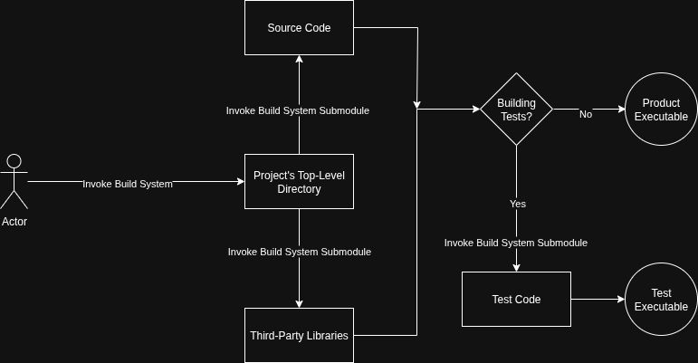
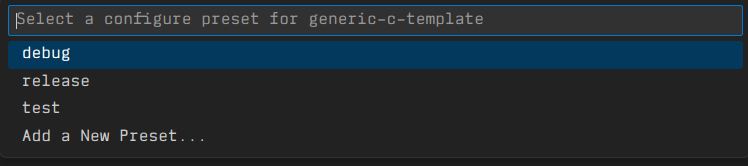

# WCE DevOps Fall 2025 Final Report

## Table of Contents

* [Definitions](#definitions)
* [Introduction](#introduction)
    * [Background](#background)
    * [Objectives](#objectives)
    * [The Fall 2025 DevOps Team](#the-fall-2025-devops-team)
* [Software Templates](#software-templates)
    * [An Overview of Templates](#an-overview-of-templates)
    * [Universal Dependencies](#universal-dependencies)
    * [The C Software Template](#the-c-software-template)
    * [Other Software Templates](#other-software-templates)
* [Collaboration](#collaboration)
    * [Open Sourcing and Contribution Philosophy](#open-sourcing-and-contribution-philosophy)
    * [Mailing List](#mailing-list)
* [Utilized Technologies](#utilized-technologies)

## Definitions

* **Automated Testing** - A system or systems integrated into a software workflow to automatically run tests on new or modified software to ensure seamless integration of new or improved features, bugfixes, or enhancements of a software product.
* **CI/CD** - "Continuous Improvement / Continuous Delivery": CI/CD are systems designed to aid teams by enforcing automation in building, testing and deployment of applications.
* **DevOps** - "Development Operations": The practice of actively integrating and maintaining CI/CD systems.
* **SCRUM** - A team-oriented and streamlined method of accomplishing larger tasks in small, atomic chunks ("sprints"). See https://www.scrum.org/resources/what-scrum-module
* **Target Platform** - The intended host of a software/firmware application with pre-determined details for the hardware or software of the host. These details could be dependencies for software, processor architecture for hardware, and any other requirements that determine the compatibility of the software being developed with the platform being targeted. Examples: The Windows operating system, the x86_64 ISA, etc.
* **Version Control** - The practice of versioning a software project so that all revisions can be easily navigated and accessed.

## Introduction

### Background

From January to August of 2025, MTU Computer Engineering student Carter Dugan completed two back-to-back co-ops with Plexus Corporation. The second co-op was for with the Plexus *Engineering Productivity* (EP) team, a small group of only six engineers who developed and maintained CI/CD pipelines and infrastructure used by the software engineers at the company. Having just completed a co-op as a software engineer with Plexus, Carter found the technologies developed by the EP team to be invaluable as a means of accelerating a modern industrial programming workflow. These technologies included:

- Pre-configured version control.
- Automated testing.
- Target platform-based software development templates.

After being given the unique opportunity to use these technologies extensively before moving to maintaining the products himself, Carter decided to bring what he learned back to Michigan Technological University in the form of an Enterprise project for the Wireless Communication Enterprise (WCE). After presenting the idea to the Enterprise advisor and members, he formed a team of three engineers and an IT specialist to bring a version of the Plexus EP team to MTU.

### Objectives

In August 2025, the WCE DevOps team began working on the project and developed a firm mission statement by September:

> *"Engineers are hired to solve a problem, and should not spend countless hours configuring their environment to solve said problem. Thus, environment configuration becomes a different problem for a different engineer to solve."*

This mission statement is a broad summary that spans multiple necessray objectives. The first of these objectives is to provide a MTU College of Computing students with a modern, industry-standard approach to developing software. This is to be accomplished via a pre-configured workflow that is agnostic to the final product. A student may wish to complete an assignment for class, develop a hobby project in leisure, or begin a collaborative group project of their own. Regardless of their needs, the DevOps team wishes to provide this in the form of pre-existing software templates that are intuitive but robust. Doing this, the team hopes to put MTU graduates on the cutting edge early on by leveraging modern technologies to provide experience with tools they will encounter in the software development industry.

Another objective was to establish a lasting presence as a long-term and dedicated team that will survive into coming years. Issues with the product are bound to be discovered for years to come, and there must be a team of maintainers to continusouly improve upon the work we have completed. To achieve this, extensive documentation was written to provide future contributors with in-depth details on our philosophy and implementation. To establish a presence, the project was presented to a professor and a small group of students to gauge interest and acquire early adopters of the technology. Unfortunately, a side-effect of the MTU Enterprise program are teams that continuously change as members come and go. As a fail-safe, the project was open-sourced to allow for outside contributions or, if necessary, a quick revival.

### The Fall 2025 DevOps Team

The WCE DevOps team consisted of the following members for the Fall 2025 semester:

- **Carter Dugan**: Team lead and Lead Software Engineer
- **Ty Miller**: Lead Infrastructure Engineer
- **Caleb Schweigert**: Software Engineer
- **Alexander Caldwell**: Infrastructure Engineer

## Software Templates

### An Overview of Templates

When building programming templates, the goal is to provide the user with baseline code and an easy interface with the build system. The skeleton of the workflow is then handled in the background with minimal dependencies. This includes things like the build system itself, the build configuration for the build system, built utilities (compilers, debuggers, etc), unit testing APIs, dependency management, and an editor configuration to tie it altogether. A popular solution to a lot of these problems are IDEs, which package a lot of this functionality into the code-editing software. As such, many courses at MTU require students to download an IDE in order to complete their coding assignments. Given the variance between course context and profressor preference, this approach proves to be unrealiable for a multitude of frustrating, time-consuming reasons, especially for those with less experience in writing code. Students simply spend far too many hours mangling their environments and even their operating systems' userspace just to get started on the coding itself.

As stated above, many professors, especially those teaching introductory courses, require their students to install IDEs. These programs typically are platform-dependent, most typically on Windows. It is not uncommon for a subset of ambitious students to come into MTU using alternative operating systems, most typically Linux-based OSes. As such, requiring programs to be written in proprietary, Windows-targeted IDEs cause those students to work around it, reducing their effeciency and discouraging the thrilling opportunity of using more complex OSes. On the other hand, some professors require their students to take a more hands-on approach by instructing them to use lightweight text editors, invoke low-level build systems directly, and target specific platforms (usually Linux). While this does provide students with experience in the finer behind-the-scenes details, it is at the expense of the confidence and drive of the less-experienced students who are given little reason as to *why* they must use those lightweight workflows. Add on top of this the additional overhead of things like unit testing, and we have a rough first week of the semester for hundreds of students.

It certainly is not easy to provide students of varying experience and ambition with an even playing field, especially when it comes to writing software for a systems-oriented cirriculum like MTU's. Therefore, the templates must be constructed with a set of modular, decoupled components. The DevOps team reduced these problems to a list of small, atomic pain-points. From their, they would be able to come up with small, atomic solutions to each pain-point that could then be compiled into one semi-autonomous system. The pain points, and thus *solution system compontents*, are as follows:

- **Target Platform**
- **Dependency Management**
- **Code Editor**
- **Build System**
- **Testing Methodology**

### Universal Dependencies

Dependencies cannot be reduced to zero. At the end of the day, students will still need a computer at the very least. As it stands, students have to install additional software dependencies for every single class. Our solution to this was to use the same dependencies for each template. This way, students need only install dependenceis for our templates *once*, and all templates would work as intended. Given that a target platform would be the biggest constraint, *containerized development* was the obvious solution to this. To setup containerized development and thus take full advantage of our templates, we list our dependencies as the following:

- Docker
- Visual Studio Code
    - The `Container Tools` plugin for Visual Studio Code.
    - The `Remote Development` plugin for Visual Studio Code.

Docker allows us to provide pre-defined `Dockerfile`s to users. These configuration files contain information about the target platform (typically Linux) and any project-specific dependencies. The latter allows us to offload the responsibility of installing required software to an automated container-building process provided by Docker. Compilers, runtimes, debuggers, libraries, anything necessary for a "Hello, world!" or any other baseline behavior, already provided by simply running Docker on our templates with the provided `Dockerfile`.

```docker
FROM alpine
CMD ["echo","hello"]
```

*Figure 1: A minimal `Dockerfile` sample*

To further optimize the workflow, the templates leverage VSCode project structure and the required extensions to provide students with even more autonomy. VSCode parses directories as "projects", and reserves the `.vscode/` directory for project configuration. In this directory, the team specifies `settings.json` with VSCode project settings, `launch.json` with build and run specifications, and `extensions.json` for VSCode extension requirements (such as linters, language tasks, etc.). These files are parsed by VSCode when you launch the editor, and allow for a snapshot of project to be used as a "ground zero". From there, users are free to install additional extensions, change settings, and modify launch tasks at will without needing to worry about the base requirements.

```json
{
  "version": "0.2.0",
  "configurations": [
    {
      "name": "Debug (active CMake target)",
      "type": "cppdbg",
      "request": "launch",
      "program": "${command:cmake.launchTargetPath}",
      "cwd": "${workspaceFolder}",
      "MIMode": "gdb",
      "miDebuggerPath": "/usr/bin/gdb",
      "preLaunchTask": "CMake: build"
    }
  ]
}
```

*Figure 2: A minimal `launch.json` sample configured for CMake*

The `Container Tools` and `Remote Development` extensions of which manual installation is required provide users with a seemless cross-platform development setup. Much like VSCode itself, they reserve a Unix-style hidden directory called `.devcontainer` that allows for multiple configuration files to be made. One of the two currently deployed by the DevOps team is the `devcontainer.json` file, which creates environment variables that are passed along to the Docker container. These envrionement variables are vital, and construct a "picture" of the project structure that is passed along to the Docker container in the form of a development workspace. This includes file access permissions, user metadata, and the container's pre-launch instructions.

```json
{
    "name": "Systems Dev Container",

    "build": {
        "dockerfile": "Dockerfile",
        "context": ".."
    },

    "remoteUser": "vscode",

    "customizations": {
        "vscode": {
            "extensions": [
                "ms-vscode.cpptools",
                "ms-vscode.cpptools-extension-pack",
                "matepek.vscode-catch2-test-adapter",
            ],
            "settings": {
                "terminal.integrated.defaultProfile.linux": "bash",
                "cmake.useCMakePresets": "always",
                "cmake.configureOnOpen": false
            }
        }
    }
}
```

*Figure 3: The `.vscode/devcontainer.json` for the C programming template.*

The second configuration file, and perhaps the most alien to users, would be the `Dockerfile` itself. The Dockerfile specifies the target platform and, optionally, the target architecture. This is all the necessary information required to build the container. From there, dependencies are installed via the "native" process. In the case of Linux and the DevOps team's needs, this is the package manager of the relevant system. This is where the magic happens, and our team is effectively able to hide dependency management from the inexperienced and overwhelmed. If a user wishes to install a dependency themselves, they can simply add a line to the installer list. This strikes a perfect balance between abstraction and control, as a user can choose which they want depending on the usecase.

```Dockerfile
# Install packages
RUN apt-get update && apt-get install -y --no-install-recommends \
    build-essential \
    gdb \
    valgrind \
    cmake \
    ninja-build \
    clang,
    clangd,
    clang-tidy,
    curl \
    git \
    ca-certificates \
    apt-transport-https \
    software-properties-common \
    sudo \
    locales \
 && apt-get clean \
 && rm -rf /var/lib/apt/lists/*
```

*Figure 4: Dependency management in the `Dockerfile` used in the C programming template.*

With these universal dependencies, we introduce a universal **code editor**, provide a portable option of writing code for a **target platform**, and eliminate the majority of **dependency management** overhead. All of this is done without restricting the user in a way that a platform-specific IDE would, providing ambitious and curious users with exciting customization options.

### The C Software Template

The C software template utilizes the universal dependencies heavily, but the most powerful utility would be the CMake build system. The WCE DevOps team constructed a CMake configuration that aids users in managing third-party libraries, creates distinct compilation and run profiles on launch, and of course handles the compilation process of the user's source code.



*Figure 5: A very basic overview of the build-system-oriented topology used by the templates.*

The template provides users with some additional utilities, such as VSCode extensions for debugging and configuration for those extensions. Using our templates, users are able to place break points and step through code line by line with `gdb`. However, a promising feature of the template is build configuration. Leveraging CMake, users can switch between different build profiles. The three pre-existing build profiles can be found in `CMakePresets.json`, and profiles can be added on the fly with ease. These preset profiles pass CMake options to the actual build information in `CMakeLists.txt`, which will configure compilation flags or even build targets based on said information. The three default presets are `Release`, `Debug`, and `Test` builds. Each can be easily selected and ran within two (2) clicks or a single VSCode command.

`Release` and `Debug` builds both build an app executable. The difference between the two is in the compiler definitions and flags. `Release` maximizes standardized optimizations (`-O2`), enforces erroneous compiler warnings, and defines a `NDEBUG` macro, a standardized macro used for conditional compilation of debug code. `Debug` disabled optimizations, generates debug symbols in the source code, softens compiler warnings and does *not* define the `NDEBUG` macro. These configurations very much mirror what the user would see in the real world, but also allows students to leave as much debug code as they want into the code. They simply have to enclose it in `#ifdef \\ #endif`.

```c
#ifndef NDEBUG
printf("The value of x at this point is %d\n", x);
#endif
```

Since the debug preset allows the user to neglect warnings, they can finish their implementation before building under release to review warnings and fix them after completing the assignment. This allows them to focus on a more refined product *just before* submitting the assignment.



*Figure 6: Users can easily switch between presets with just two clicks or a single command.*

The `Test` preset is more unique and resolves the **testing methodology** issue. Whereas the Java template utilizes a testing framework pre-packaged into the build system, the C template elects to use a third party library called *rktest*. Under the hood, the `Test` preset is a wrapper for either a debug *or* release preset with an important difference: it does not build an app, but instead builds a `tests` binary using the `rktest.c` source file provided by the API, as well as any test files inside of `tests/`. Users can utilize the well-documented API to write their own tests in source files placed in the `tests/` directory, and then run the tests using the `Test` preset.

If the user wishes to include additional libraries, CMake provides many options. The easiest way to do so is to leverage our template and the CMake `submodules()` function. If a user has a library that builds with CMake, they can simply drop the entire root into our `lib/` directory. From there, the `lib/CMakeLists.txt` will include the library for you without any additional steps. After all of this, building, testing, and packing libraries into C software is easier than ever before.

### Other Software Templates

In addition to the C programming template, there are additional programming templates. One of which, the Java template, is a deployable state. While many of the principles remain the same, the differences in build system, extensions, and dependencies are what make the adapter layer of Docker and VSCode so helpful. For example, the Java template makes use of a much more abstracted build system called *Maven*, which which provides automatic project setup and configuration of Debug, Release, and Test builds. Due to the overcomplicated nature of Java projects, our Maven-generated project was heavily modified to cooperate with VSCode to run natively within the editor.

In addition to these completed template, there are multiple work-in-progress templates. This includes a C++ template, an embedded C template, and a Python Machine Learning template. Each exist in separate branches and are exposed in the GitHub, making them prime opportunities for teams to build off of in the future.

### Collaboration

#### Open Sourcing and Contribution Philosophy

Our goal was to create a collaborative environment that minimized confusion, preserved code quality, and encouraged meaningful participation from both internal team members and the wider community. Our strategy was centered around Trunk-Based Development, a development model that prioritized the use of a Continuous Integration/Continuous Delivery (CI/CD) pipeline to streamline the software development process. The central “trunk” or main branch would be continuously updated to allow for expansion and organization of the project. This development process was chosen because it aligns with our need for rapid iteration while keeping the project's history clean and understandable for future users. By using a standardized versioning format, we created a predictable method for keeping track of the team’s progress over time. We categorized branches into feature, bugfix, and hotfix. This allowed our team to communicate intent to the rest of the team through naming conventions, reducing ambiguity. When these were added to the main branch, we required a rebase before merging to keep our repository clean as well as a submission of a pull request (PR) so another member could approve of the merge.

We decided to make the project open source as it was a main part of our contribution philosophy. By doing this we allowed fellow students and professors to view and interact with the code base which in turn expanded our pool of collaborators beyond our team. This gave us more templates to work on and help from other perspectives and skill levels. On the other hand, the community gained access to a transparent educational resource that demonstrated industry-standard workflows like PR reviews, merge strategies, conflict resolution, and structured documentation. Students would be able to learn by doing and professors could create templates for their classes and homework assignments respectively.

Our philosophy of continuous improvement and delivery was reinforced by making this project open source. This helped to increase the likelihood of long-term sustainability. As projects usually struggle to survive the transition between semesters, this project was aimed at ensuring progress was visible, and easily continued by future contributors. The formal review process supported this continuity by creating a historical record of how and why changes were made. This strategy helped to ensure that the final state remained understandable even with many separate contributors iterating on their branches. By designing our collaboration model around clarity, accessibility, and university involvement, we increased the odds that our project will remain functionable and maintainable for future students. The contribution philosophy documented here reflects our intent to build not only a working codebase but also a sustainable ecosystem for future developers and the longevity of the project.

#### Mailing List

As this project relies on the people we develop for, we have a need for a mailing list to send out updates on the project. We used two tools to create this mailing list: Listmonk and Hostinger. 
	Listmonk is an open-source software that allows you to create and manage multiple mailing lists from one central account. It is hosted using the web service provider Hostinger on a VPS. Hostinger came with a free domain that everything runs through, “wce-devops.cloud” which I then made a subdomain “mail.wce-devops.cloud” for everything to run through. Currently, if you visit the website, you’ll be greeted by a login screen that allows you to log in to the admin panel of Listmonk or go to the page that allows you to subscribe to the currently available mailing lists.
	The main struggle while trying to get Listmonk to work was the lack of web hosting knowledge, and just trying to get everything to the point where you could access the website from any computer. That has been the biggest time sink of this part of the project, but everything is, currently, working as intended.
	The future of this part of the project is to alter the layout of the website to make it more oriented towards the user and to get a few mailing lists set up and provided to those who would like to sign up for them.


